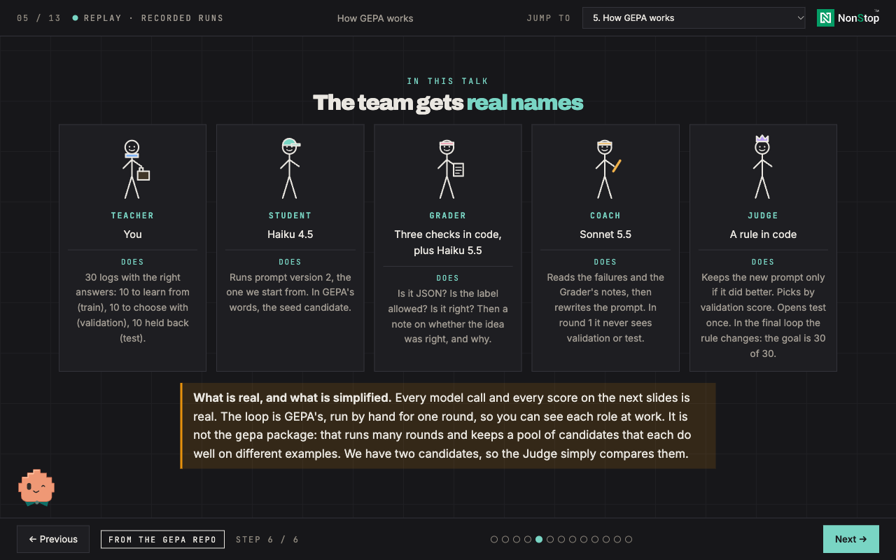
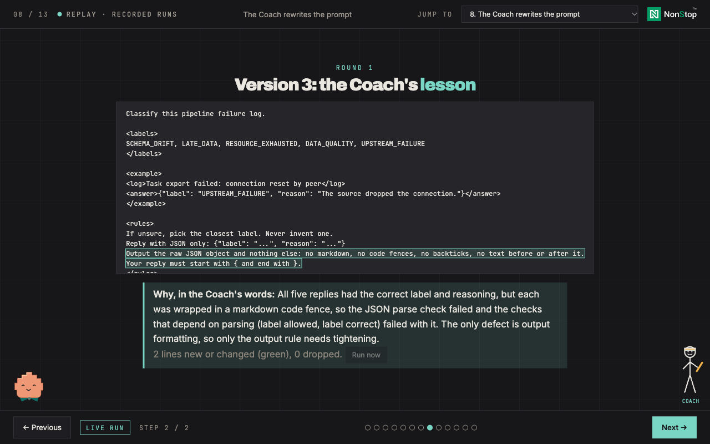
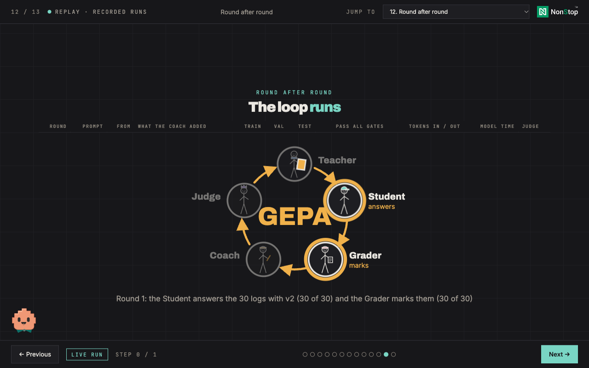

# Data Engineering for Prompt Optimization

[](https://github.com/ProjectAJ14/gepa-prompt-optimization/actions/workflows/ci.yml)
[](LICENSE)

An interactive walkthrough that shows how a prompt optimizer like [GEPA](https://github.com/gepa-ai/gepa) works, and what you have to build around it before you believe its results. It was made to be presented instead of slides: press **Next** and one thing appears.

It is not a mock-up. Every model reply and every score on screen comes from a real call to Claude (Haiku 4.5 answers, Haiku 5.5 grades, Sonnet 5.5 rewrites the prompt), made through the `claude` command-line tool. A prompt goes from a one-liner to version 2 by hand, gets a score, meets five stick-figure characters (Teacher, Student, Grader, Coach, Judge), and then runs GEPA's loop for real: the Coach reads the failures, rewrites the prompt, and the Judge keeps it only if it did better.

| How GEPA works | The Coach rewrites the prompt | The loop runs |
|---|---|---|
|  |  |  |

**What it is not:** the loop on the later slides is GEPA's idea done by hand with real model calls, one round at a time. It is not the `gepa` package, and the slides say so. The data is 30 invented pipeline-failure logs, ten per split, so the numbers show how the method behaves, not how good it is.

## Run it

You need **Node.js 20 or newer**. Nothing to install: there are no dependencies.

```bash
git clone https://github.com/ProjectAJ14/gepa-prompt-optimization.git
cd gepa-prompt-optimization
```

### Option 1: replay a recorded run (no account, no cost)

```bash
node server.mjs --replay
```

Open <http://127.0.0.1:8787> and press **Next**. The page shows the recorded run that ships in `recordings/` (464 model calls). Nothing calls a model, so it works offline and cannot fail on stage. **Run now** and **Start from empty** are switched off in this mode, on purpose.

### Option 2: run it live with your own Claude login

1. Install [Claude Code](https://docs.anthropic.com/en/docs/claude-code) and log in, so that `claude -p "hello"` prints an answer. The server uses your login and never asks for or stores a key.
2. Start the server and open the page:

   ```bash
   node server.mjs
   ```

   Open <http://127.0.0.1:8787>. The top of the page says **Live** and names the three models.
3. Step through with **Next**. Every call is made when you reach the slide that needs it, and every answer is saved in `.cache/llm.json` (git-ignored), so a second pass is instant.
4. On the title screen, **Warm up the live calls** makes every call the walkthrough needs in one go, and **Start from empty** forgets every recording (it keeps a backup in `.cache/`) so the next run is entirely new.

A full run from empty is about 400 model calls: roughly ten minutes and, at the models' list prices, about 40 cents (the author's run). Replies vary, so the Coach may write a different prompt than the one in the recording and the loop may take a different route.

To reuse the shipped recordings in live mode, copy them in first: `mkdir -p .cache && cp recordings/llm.json .cache/`.

Change the models with `ACTOR_MODEL`, `GRADER_MODEL` and `COACH_MODEL`, the port with `--port 8788`, and where recordings are kept with `CACHE_DIR`:

```bash
COACH_MODEL=claude-opus-5-5 node server.mjs --port 8788
```

### Keys

Right arrow or Space: next. Left arrow: previous. **N**: speaker notes. The **Jump to** menu in the header goes to any slide.

### Presenting it

Run the live mode once beforehand so everything is recorded, then present with `node server.mjs --replay`. Keep a copy of `.cache/llm.json` somewhere safe. Do not press the Coach's **Run now** on slide 8 in front of an audience: it asks the Coach again, which can write a different prompt and sends the loop on slide 12 through hundreds of new calls.

## The 13 slides

1. Title
2. Version 1: the one-liner everybody writes, run for real
3. Version 2: five techniques added one at a time (labels, an example, edge cases, an output format, XML tags last)
4. What GEPA is, and where to get it
5. How GEPA works: Teacher, Student, Grader, Coach, Judge, the loop, and the real models behind them
6. We need a score: 30 logs, the right answers, a split by pipeline, three gates, and a judge's note
7. Student and Grader on five training logs
8. The Coach rewrites the prompt
9. The Student tries again on the same five logs
10. The Judge decides: beat the parent, then check logs it has never seen
11. The test split, opened once
12. Round after round: the loop repeats until one prompt passes all 30 logs (this spends the test split, and the slide says so)
13. The checklist and the questions

Every call on screen shows its exact prompt, its full reply, the grader's verdict and reason, when it ran, how long it took, how many tokens it used, and a **Run now** button.

## How it works

- `index.html` is the whole front end in one file. `server.mjs` is a small Node server with no dependencies that serves it and runs the model calls with `claude -p`.
- The child process gets no tools, no hooks, no MCP servers and no saved session: the prompt under test is its whole input. The server listens on 127.0.0.1 only, checks the `Host` header, and needs a custom header and a JSON body on every POST. See [SECURITY.md](SECURITY.md).
- Answers are cached by model, system text and exact prompt, so changing a prompt means new calls.
- Scoring is strict: a reply must be JSON with a `label` and a `reason`, the label must be one of five, and it must be right. A failed gate keeps the score under 0.5. A code-fenced reply fails the first gate, which is what the first Coach finds.

## Develop

`src/template.html` is the source. `index.html` is built from it by `build.py`, which inlines the design tokens and the mascot from the [Eklavya](https://github.com/ProjectAJ14/eklavya) repository (MIT). You only need this to change the slides:

```bash
git clone https://github.com/ProjectAJ14/eklavya.git ../eklavya
python3 build.py --eklavya ../eklavya          # rewrites index.html
EKLAVYA_DIR=../eklavya scripts/check-all.sh    # build, numbers, render every step, server tests, loop tests, design grep
```

`scripts/check-all.sh` calls no model. Without an Eklavya checkout it skips the build and checks the committed `index.html`. [CLAUDE.md](CLAUDE.md) and `.claude/rules/` hold the rules for changing the slides, and [docs/decisions.md](docs/decisions.md) records what was decided, what the runs showed, and what is not verified. [CONTRIBUTING.md](CONTRIBUTING.md) is the short version.

| Path | What it is |
|---|---|
| `src/template.html` | The source: markup, styles, every slide, the logs, scoring and the loop |
| `index.html` | Built from the template. Committed so it runs with no build |
| `server.mjs` | The local server: serves the page and runs the model calls |
| `recordings/llm.json` | One recorded run, for `--replay` |
| `src/linkedin-qr.svg`, `scripts/make-qr.py` | The closing slide's QR code, and the dependency-free script that made it. Point it at your own profile if you reuse the deck |
| `scripts/` | `check-all.sh`, the server tests (against a fake `claude`), the loop tests (against a stub server), the render check |
| `docs/` | The decisions log and the screenshots above |

## Credits and licences

Code: MIT, see [LICENSE](LICENSE). The design tokens and the mascot are from [Eklavya](https://github.com/ProjectAJ14/eklavya) (MIT, same author). The stick figures and the loading critter are original drawings. GEPA is by its authors at [gepa-ai/gepa](https://github.com/gepa-ai/gepa) (paper: [arXiv 2507.19457](https://arxiv.org/abs/2507.19457)); every claim about it on the slides comes from its README. The NonStop io logo in the header is NonStop io's trademark and is not covered by the MIT licence (see [NOTICE.md](NOTICE.md)): remove `src/nonstop-logo.svg` and rebuild if you reuse the page.
